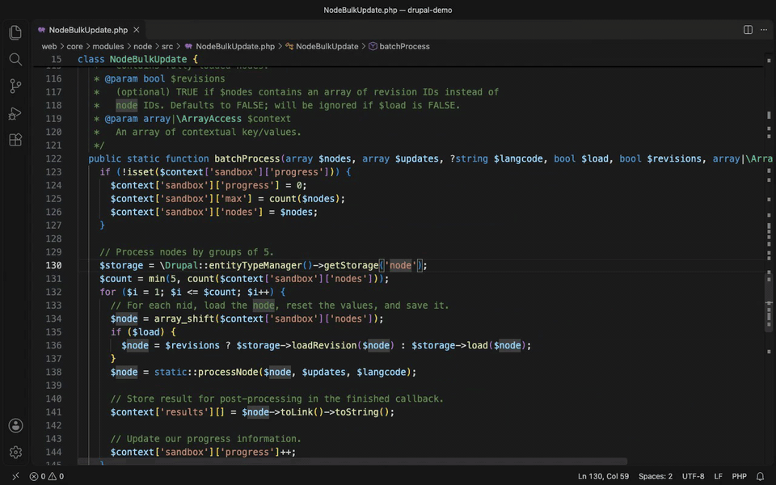

<p align="center">
  
</p>

<h1 align="center">PHPlumb</h1>

<p align="center"><strong>Fast code navigation in VS Code for reviewing PHP that AI agents write.</strong></p>

Jump from a call to its definition, from an interface to its implementations, and from a method to every place that calls it, in a project of 40,000 PHP files, without waiting.



## Why

AI agents write a lot of PHP, fast. Reviewing it means reading: following calls across classes to check that the code is correct and does what you asked.

The PHP extensions for VS Code make that slow. Indexing a large project takes a long time, the free tier of Intelephense has no "find implementations", and on Drupal code the type of an object is lost as soon as it leaves the service container, so navigation stops there.

PHPlumb is built for that review loop. It has its own engine, written in Rust, and does one thing: navigation.

## Features

- **Go to definition** for classes, interfaces, traits, enums, functions, methods, properties, constants and enum cases, through type inference and PHPDoc types. Names in docblocks work too: classes in PHPDoc types, members and functions in `@see`, and annotation names.
- **Find implementations** of an interface, an abstract class or a method, transitively.
- **Find all references**, including calls made through the interface or parent method that a method implements.
- **Call hierarchy** with incoming and outgoing calls, and **type hierarchy** with supertypes and subtypes.
- **Hover** with the resolved type, the signature and the docblock.
- **Symbol search** across the workspace (Cmd+T) and the outline of the current file.
- **Broken reference diagnostics.** Classes, functions, methods and constants that exist nowhere are flagged in project code, so code an agent invented stands out. A warning on working code is a bug.

Agents edit files outside the editor, often many at once. PHPlumb follows changes on disk, including a branch switch, without you opening the files. The index is cached, so reopening a project skips files that did not change.

## Drupal

PHPlumb starts with Drupal, because its code calls almost everything through interfaces and services. What works today:

- `.module`, `.inc`, `.install`, `.theme`, `.profile` and `.engine` files are indexed as PHP.
- Inside `vendor`, only the code that Composer's autoloader reaches is indexed, so package tests and leftover copies never show up as targets.
- Broken reference diagnostics are tested against Drupal core and contrib for false alarms.
- **Annotations.** `@Block(...)`, `@Translation(...)` and other plugin annotations lead to their annotation class, imported or not, as plugin discovery resolves them.
- **Services.** `\Drupal::service('id')` and `$container->get('id')` are typed from every `*.services.yml`, so navigation continues on the next call. Cmd+click on a service id opens its definition.
- **Entities.** `getStorage('node')` is typed as the storage class of that entity type, and `->load()` as the entity class, from entity types declared by attributes or annotations. Cmd+click on an entity type id opens its declaration.
- **Hooks.** Cmd+click on a hook implementation, a `#[Hook]` method or a procedural `mymodule_form_alter()`, opens the places that invoke the hook and its `hook_*` documentation. Cmd+click on the hook name in `invokeAll('cron')` or `alter('form')` lists every implementation. Hooks invoked under computed names, such as `hook_form_FORM_ID_alter` or `hook_ENTITY_TYPE_presave`, lead to the core code that computes them.
- **Plugins.** Cmd+click on a plugin id opens its class: `'#type' => 'textfield'`, `BaseFieldDefinition::create('string')`, widget and formatter types in `setDisplayOptions()`, `addConstraint('Name')` and `createInstance('id')` on a plugin manager. Go to implementations on a plugin manager lists all its plugins. Plugins are found by attribute or annotation, the way Drupal discovers them.
- **Routes and YAML.** Cmd+click on the route name in `Url::fromRoute('name')`, `Link::createFromRoute()`, `setRedirect()` or `redirect()` opens the route in `*.routing.yml`. In services, routing and links YAML files, Cmd+click on a class, a `Class::method`, a `service:method` controller, an `@service` or a route name opens its definition.
- **Broken Drupal references.** A service id, route name or plugin id written in PHP that is defined nowhere on disk, test modules included, is reported: `\Drupal::service('x')`, `Url::fromRoute('x')`, `'#type' => 'x'`, field types, widgets and formatters. Ids that code builds at run time, and lookups that tolerate a missing id, stay silent. Nothing is reported while `phplumb.exclude` is set, since ids defined in excluded files are unknown.

## Speed

Measured on a Drupal 11 project with 39,417 PHP files, on an Apple M3 Pro.

| Task                                                    | Time          |
| ------------------------------------------------------- | ------------- |
| Index the whole project from scratch                    | 2 to 4 s      |
| Start again from the cache                              | 1.7 s         |
| Find 1,033 references of `EntityStorageInterface::load` | 100 to 135 ms |
| Search symbols across the workspace                     | about 30 ms   |

Peak memory stays under 500 MB. See [the benchmark history](docs/benchmarks.md) for every run.

## Install

PHPlumb runs on macOS (Apple silicon) and Linux (x64), in VS Code 1.140 or later.

1. Download the `.vsix` for your platform from the [releases page](https://github.com/lussoluca/phplumb/releases).
2. Install it:

   ```sh
   code --install-extension phplumb-darwin-arm64-0.1.0.vsix
   ```

3. Open a PHP project. Indexing progress appears in the status bar.

**Disable Intelephense and other PHP navigation extensions** in workspaces where you use PHPlumb, or you will see every result twice.

## Settings

| Setting                       | Default  | Description                                                                                              |
| ----------------------------- | -------- | -------------------------------------------------------------------------------------------------------- |
| `phplumb.exclude`             | `[]`     | Glob patterns, relative to the workspace folder, of paths not to index.                                  |
| `phplumb.diagnostics.enabled` | `true`   | Reports names that do not exist, in project code outside `vendor`, Drupal core and contrib.              |
| `phplumb.frameworks.drupal`   | `"auto"` | Drupal support: `auto` turns it on when `composer.lock` requires `drupal/core`; `on` or `off` forces it. |
| `phplumb.server.path`         | `""`     | Path of the `phplumb` binary. Empty uses the bundled binary.                                             |
| `phplumb.trace.server`        | `"off"`  | Traces the communication between VS Code and the engine: `off`, `messages` or `verbose`.                 |

The **PHPlumb: Restart Server** command restarts the engine. The **PHPlumb** output channel shows its log.

## What it does not do

PHPlumb is for reading code. It has no autocomplete, signature help, rename or other refactorings, formatting, code actions or debugging.

## Status

PHPlumb is young (0.1.0). Core PHP navigation, diagnostics and the Drupal features above are complete.

## Development

PHPlumb has two parts: an engine in Rust (`crates/`) that speaks the Language Server Protocol, and a thin VS Code extension (`editors/vscode`) that starts it. See the [development guide](docs/development.md) to build, test and package it.

## License

[MIT](LICENSE). The list of PHP built-in names comes from [JetBrains phpstorm-stubs](https://github.com/JetBrains/phpstorm-stubs), under the Apache License 2.0; see [its notice](crates/phplumb-index/data/README.md).
